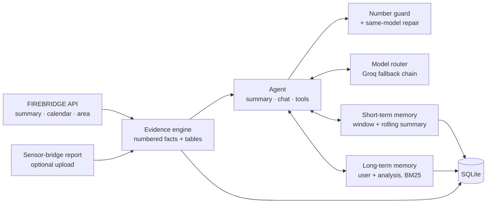

# FireBridge AI Agent

An explainer agent for [FIREBRIDGE](https://astramind.solutions/) satellite fire analyses. Give it an analysis id (and, optionally, the sensor-bridge report exported by the FIREBRIDGE frontend). It writes a grounded executive summary and then answers questions about the analysis in a chat. It remembers the conversation and the user across sessions.

The agent never invents a statistic. Every number comes from code that reads the FIREBRIDGE data. The language model only explains those numbers, citing the facts it used, and a number guard checks every answer against what the model was shown.

## How it works



1. **Evidence engine** (`data/evidence.py`). It turns native detections, the per-satellite inventory and the harmonization report into short numbered facts (`[F5] Busiest month: July 2022 with 1,168 detections…`), plus month, day and year tables.
   - Availability is judged per satellite: a superseded MODIS collection, or a satellite not launched yet, is not missing data.
   - Missing data is never zero.
2. **Agent** (`agent/agent.py`). It handles summaries and chat.
   - **Summaries** are JSON with cited findings, rendered to Markdown and cached per language.
   - **Chat** runs a bounded tool loop over the evidence tables: `get_month`, `get_day`, `compare_periods`, `top_months`, `unusual_months`, `largest_episodes`, `handover_rehearsals` and `search_facts`.
3. **Number guard** (`agent/guard.py`). Every number in an answer must match the evidence, a tool result or the question. It allows for rounding, percentages and French or Arabic number formats.
   - If a number does not match, the **same** model gets one chance to repair its answer; a weaker model is never used for this.
   - The verification result is returned with every answer.
4. **Model router** (`llm/router.py`). It keeps answering when free-tier models run out of quota. See below.
5. **Memory** (`memory/`). Short-term memory keeps recent turns verbatim and folds older ones into a rolling summary. Long-term memory stores durable facts about the user and the analysis.
6. **Scope guard** (`agent/safety.py`). The agent only discusses the analysis, and refuses prompt-injection attempts. See [Scope and prompt injection](#scope-and-prompt-injection).

## Quick start

```bash
cp .env.example .env              # then set FBA_GROQ_API_KEY
make install && make run          # http://localhost:8000/docs
uv run python examples/client.py  # loads the northern Morocco sample, prints the summary, opens a chat
```

With Docker:

```bash
make docker-build && make docker-up   # http://localhost:8000, data in the agent-data volume
make docker-logs
```

The image runs as a non-root user on a read-only filesystem, with a health check. `.env` is excluded from the build context, so the key is only ever supplied at runtime.

## The model chain

The default chain is `qwen/qwen3.8-27b` → `openai/gpt-oss-120b` → `openai/gpt-oss-20b` → `allam-2-7b` (`FBA_MODELS`).

On Groq's free tier each model allows about 8,000 tokens per minute and 1,000 requests per day. A single chat turn with a tool call uses about 6,000 tokens, so switching is routine. The router handles it as follows:

- **Switches before a 429 when it can.** Each response carries the remaining tokens in its rate-limit headers. The router projects the continuous refill, and a model that probably lacks tokens for the next request is tried last instead of first.
- **Switches after a 429.** A model that answers 429 cools down for exactly the time Groq gives (`retry-after`, or the reset headers; the daily limit cools down for hours). The request moves on to the next model.
- **Handles other failures.** A missing or decommissioned model, or a 5xx, cools down for 5 minutes. Network errors and timeouts get one retry with backoff, then the next model. A malformed tool call goes to the next model. An invalid key stops the request immediately with a clear error.
- **Respects capabilities.** Tool calls go only to tool-capable models, and prompts that are too long skip small context windows. `allam-2-7b` is reserved for housekeeping (conversation compaction and memory extraction), never user-facing answers. Housekeeping tries `FBA_HOUSEKEEPING_MODELS` first to spare the main chain.
- **Rejects broken output.** Looping or truncated output is rejected, and another model answers.
- **Degrades instead of failing.** When every model is cooling down, the router waits if the wait is short (`FBA_MAX_WAIT_FOR_MODEL_S`). Otherwise:
  - **Chat** returns the facts most relevant to the question, without generated text and with `retry_after`, in the session language.
  - **Summaries** fall back to a deterministic template.

`GET /v1/models` shows each model's availability, cooldown, remaining tokens, calls by purpose, failures, and the fallback and proactive-switch counters.

## Memory

| Layer | What it keeps | How |
|---|---|---|
| Short-term (per session) | The last `FBA_SHORT_TERM_TURNS` turns verbatim, within a token budget | When the window overflows, older turns are folded into a rolling summary by an LLM call. If no model is free, an extractive summary is used instead. |
| Long-term (across sessions) | What each user said about themselves: preferences, profile, and what they are investigating | After each answer, a background call proposes up to 3 memories as JSON. Each is validated and de-duplicated: a near-duplicate reinforces the existing memory. Each user keeps their 200 most valuable entries. Claims about the data are never stored: an answer can be wrong, and a stored mistake would be served to later users. The evidence facts are the authoritative conclusions. |
| Recall | Up to `FBA_LONG_TERM_TOP_K` memories per question | Who the user is and how they want answers always come along. Other memories need BM25 relevance to the question, weighted by importance and use. |
| Evidence cache | Built evidence packs and summaries per language | Rebuilding an analysis invalidates its cached summaries. |

Users can inspect memories (`GET /v1/memories`) and delete one or all of them (`DELETE /v1/memories/{id}`, `DELETE /v1/users/{user_id}/memories`).

## Scope and prompt injection

The agent only discusses the analysis it was given: its detections, months, satellites, harmonization and the limits of the data, plus the fire science and app usage needed to read them. Anything else gets a fixed refusal in the session language.

| Layer | What it stops | How |
|---|---|---|
| Screen (`agent/safety.py`) | Plain attempts to override the rules, change the assistant's role, extract the system prompt or fake a system turn, in all seven app languages | Patterns over normalized text: case, accents, Arabic diacritics, and invisible and full-width characters are folded. The screen checks the message and the app context before any model call, so a refused attempt costs no tokens. |
| Scope rules (system prompt) | Off-topic requests, and paraphrased attempts the screen misses | The model replies `OUT_OF_SCOPE`, and the server replaces it with the fixed refusal. Memories, the conversation summary and the app context are labelled as data and flattened to one line. |
| No persistence | An attempt that comes back in later turns | Refused turns stay in the session history for audit (`meta.refused`), but they are never replayed into a prompt or a summary, and no memory is extracted from them. Memory candidates that address the assistant or its rules are dropped. |

## API

| Method | Path | Purpose |
|---|---|---|
| `GET` | `/health`, `/ready` | Liveness; readiness (database, key, models) |
| `GET` | `/v1/models` | Model chain status and usage |
| `POST` | `/v1/analyses` | Load an analysis: `{analysis_id, report?, use_api?}` |
| `GET` | `/v1/analyses`, `/v1/analyses/{id}` | Known analyses; evidence facts |
| `POST` | `/v1/analyses/{id}/summary` | Grounded summary: `{language, refresh}` |
| `POST` | `/v1/sessions` | Start a chat: `{analysis_id, user_id?, language}`. Loads the analysis from FIREBRIDGE on first use. |
| `GET`, `DELETE` | `/v1/sessions/{id}` | History (with model, tools, verification per answer); delete |
| `POST` | `/v1/sessions/{id}/messages` | Ask: `{content}` |
| `GET`, `DELETE` | `/v1/memories`, `/v1/memories/{id}`, `/v1/users/{user_id}/memories` | Long-term memory |

```bash
curl -s -X POST localhost:8000/v1/sessions -H 'content-type: application/json' \
  -d '{"analysis_id":"13ad2e0c-cd43-4ee9-bcc6-fd8b273beb70","user_id":"amina","language":"fr"}'
curl -s -X POST localhost:8000/v1/sessions/<id>/messages -H 'content-type: application/json' \
  -d '{"content":"Pourquoi août 2020 est-il contesté ?"}'
```

Every chat answer returns:

- `answer` and its `citations`;
- `verification` (`verified` or `unverified_numbers`, with the offending numbers);
- the `tool_calls` made;
- `attempts` (every model tried, and why it was skipped);
- `usage` (token counts);
- `memories_used`;
- `generated_from`: `llm`; `fallback` when every model was busy; or `refusal`;
- `refusal` when the message was refused: `injection` (screened out, no model call) or `out_of_scope` (declined by the model).

Errors share one shape, `{"error": {"code", "message", "request_id", "details"}}`, and a `Retry-After` header where relevant. Every response carries `X-Request-ID`.

To get the richest answers, upload the sensor-bridge report. In the FIREBRIDGE frontend, use *Sensor bridge → Full report (JSON)*. It adds the satellite jury, the drift fingerprint, the handover rehearsal and the harmonized record to the evidence. `examples/bridge_report_northern_morocco.json` is a trimmed real one.

## Configuration

All settings are environment variables (or `.env`). See `.env.example`.

| Variable | Default | Meaning |
|---|---|---|
| `FBA_GROQ_API_KEY` | — | Groq key. Takes precedence over a generic `GROQ_API_KEY` that may be exported in your shell. |
| `FBA_MODELS` | 4-model chain above | Fallback order |
| `FBA_HOUSEKEEPING_MODELS` | `gpt-oss-20b`, `allam-2-7b` | Tried first for compaction and memory extraction |
| `FBA_FIREBRIDGE_API_URL` | live API | Source of analyses |
| `FBA_DATABASE_PATH` | `data/agent.db` | SQLite file |
| `FBA_SERVICE_API_KEYS` | `[]` (open) | Keys clients must send as `X-API-Key` |
| `FBA_RATE_LIMIT_PER_MINUTE` | `30` | Per client key or IP, on `/v1` |
| `FBA_MAX_TOOL_STEPS` | `4` | Tool-loop bound per answer |
| `FBA_DIGEST_TOKEN_BUDGET`, `FBA_CHAT_DIGEST_TOKEN_BUDGET` | `1800`, `1200` | Evidence in the prompt (summary, chat). Tools reach the rest. |
| `FBA_SHORT_TERM_TURNS`, `FBA_SHORT_TERM_TOKEN_BUDGET` | `8`, `1600` | Short-term window |
| `FBA_LONG_TERM_TOP_K`, `FBA_MEMORY_EXTRACTION` | `5`, `true` | Long-term recall and extraction |
| `FBA_MAX_WAIT_FOR_MODEL_S` | `20` | Longest wait for a cooling-down model |
| `FBA_LOG_LEVEL`, `FBA_LOG_JSON` | `INFO`, `true` | Structured logs with request ids |

## Development

Production CI/CD and server operations are documented in [deploy/README.md](deploy/README.md).
Pushes to `main` automatically validate, publish and deploy the verified image to
`https://astramind.solutions/agent/`; pull requests run checks without deploying.

```bash
make test     # 138 tests, no network: scripted LLM, mocked Groq and FIREBRIDGE transports
make lint
```

| Path | Contents |
|---|---|
| `src/firebridge_agent/llm/` | Model catalog, Groq client (typed errors, rate-limit headers), router |
| `src/firebridge_agent/data/` | FIREBRIDGE client, satellite mapping, evidence engine |
| `src/firebridge_agent/agent/` | Prompts, tools, number guard, agent orchestration |
| `src/firebridge_agent/memory/` | SQLite store, short- and long-term memory, BM25 |
| `src/firebridge_agent/api/` | Routes, schemas, auth, rate limiting |
| `src/firebridge_agent/main.py` | App factory, middleware, error handling |

## Limits

- **The number guard checks values, not meaning.** A correct number attached to the wrong month passes. The prompt forbids computing new ratios, and evidence citations make claims checkable.
- **The injection screen is a first filter, not a proof.** It catches common phrasings, and a determined user can paraphrase past it. The scope rules in the prompt are the second line. What limits the damage is what the agent can do: its tools only read the evidence pack, and memories are per user. An attempt that gets through can produce off-topic text, but it cannot change data or reach other users.
- **Free-tier quotas cap throughput** at roughly 3–6 chat turns per minute across the chain. Under sustained load, answers slow down while models cool down, then degrade to fact lists.
- **Rate limiting and model state are in memory and per process.** Run one replica, or move them to Redis before scaling out.
- **The agent explains FIREBRIDGE results; it adds no new science.** Its answers inherit the limits of the evidence: detections are not fires, the harmonized record is an estimate, and these data do not establish causes. It is not an emergency or warning service.
